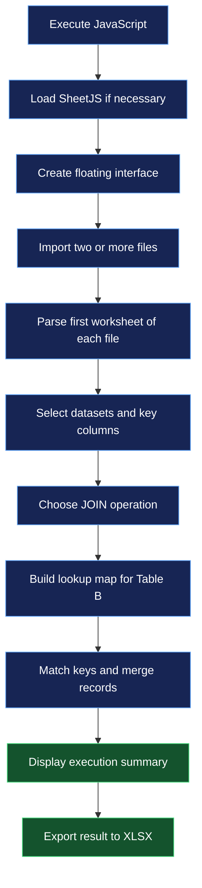

# 🔗 Cross Data Scrap

<p align="center">
  <strong>Relational Data Integration · Client-Side Processing · Excel Export</strong>
</p>

<p align="center">
  A browser-based utility for combining structured datasets through configurable relational joins, using primary and foreign key relationships.
</p>

<p align="center">
  
  
  
  
</p>

<p align="center">
  <a href="#-overview">Overview</a> ·
  <a href="#-features">Features</a> ·
  <a href="#-how-it-works">How It Works</a> ·
  <a href="#-join-operations">JOIN Operations</a> ·
  <a href="#-limitations-and-considerations">Limitations</a>
</p>

---

## 📌 Overview

**Cross Data Scrap** is a JavaScript utility that creates an interactive data-integration panel directly inside a web page. It allows users to import multiple tabular files, select two datasets, define a relationship between their columns, execute a relational join, and export the resulting records to an Excel workbook.

The application implements the core logic of relational data combination without requiring the user to write SQL queries or configure a database connection.

Its processing pipeline is based on three principal operations:

1. **Data ingestion:** reading CSV and Excel files and converting their first worksheets into JavaScript objects.
2. **Relational matching:** comparing selected key columns and merging records according to the chosen join operation.
3. **Result serialization:** converting the resulting collection of objects into a downloadable `.xlsx` file.

The interface is dynamically generated and injected into the current document. Consequently, the script can function as an in-page utility when executed in a compatible browser environment.

### 🎯 Intended use cases

- Reconciling records across separate spreadsheets.
- Enriching a primary dataset with attributes from a secondary dataset.
- Identifying records that do not have corresponding entries in another table.
- Combining reference tables with transaction or customer datasets.
- Performing preliminary data preparation before analysis in Excel, Power BI or Python.
- Exploring relational data concepts without writing SQL.

---

## ✨ Features

| Feature | Description |
|---|---|
| 📂 Multiple file imports | Loads two or more CSV, XLS or XLSX files in a single selection. |
| 📊 Tabular data conversion | Uses SheetJS to convert the first worksheet of each workbook into JavaScript objects. |
| 🔑 Configurable relationships | Allows the user to select the primary dataset, its key column, the secondary dataset and its corresponding foreign key column. |
| 🔀 Three JOIN modes | Implements `LEFT JOIN`, `INNER JOIN` and `FULL JOIN`-style operations. |
| 🧩 Column collision handling | Prefixes certain conflicting secondary-table columns with `B_`. |
| 📈 Execution summary | Displays input row counts, the selected operation and the number of output rows. |
| 📥 Excel export | Generates a workbook containing the result and downloads it locally. |
| 🌐 Bilingual interface | Supports Portuguese and English interface labels. |
| 🪟 Floating interface | Provides a draggable, resizable panel with minimize, maximize and close controls. |
| 🎨 Dynamic styling | Injects a dark interface with a moving gradient, translucent backgrounds and interactive controls. |
| 🧹 State reset | Clears loaded datasets, previous results and the current file selection. |

---

## 🧰 Technology Stack

| Technology | Role in the application |
|---|---|
| JavaScript (ES6+) | Controls application state, file processing, relational matching and interface interactions. |
| SheetJS (`xlsx`) | Reads spreadsheet files and generates the output Excel workbook. |
| HTML | Defines the dynamic interface, forms, selectors, buttons and result panel. |
| CSS | Provides layout, animations, colors, responsive sizing and interaction states. |
| DOM API | Creates, inserts, updates and removes interface elements at runtime. |
| Browser File API | Reads the contents of files selected by the user. |

The script loads SheetJS version `0.18.5` from the Cloudflare CDN when the library is not already available in the execution environment.

```javascript
if (typeof XLSX === 'undefined') {
    await new Promise((resolve, reject) => {
        const script = document.createElement('script');

        script.src =
            'https://cdnjs.cloudflare.com/ajax/libs/xlsx/0.18.5/xlsx.full.min.js';

        script.onload = resolve;
        script.onerror = reject;

        document.head.appendChild(script);
    });
}
```

This initialization checks whether the `XLSX` object already exists. If it does not, the script inserts an external JavaScript resource and waits for it to load before continuing.

The `Promise` coordinates the asynchronous loading process: `resolve` allows execution to continue after a successful load, while `reject` signals a loading failure.

**Dependency requirement:** the page must be able to access the CDN when SheetJS is not already available. The script does not include a local copy of the library.

---

## ⚙️ How It Works

The application is organized around a sequence of operations, from initializing the interface to exporting the final dataset.



### 1. Application initialization and state management

The script begins by creating the principal variables used throughout its execution.

```javascript
let datasets = {};
let finalResult = [];
let currentLang = 'pt';
```

These variables have distinct responsibilities:

- `datasets` stores the imported tables and their associated metadata.
- `finalResult` stores the records produced by the most recent join.
- `currentLang` determines which translation dictionary is used by the interface.

The imported datasets are organized by filename. Each entry contains the filename, its parsed records and its column names.

Conceptually, the structure resembles the following:

```javascript
datasets = {
    "customers.xlsx": {
        name: "customers.xlsx",
        data: [
            { customer_id: 101, name: "Ana" },
            { customer_id: 102, name: "Bruno" }
        ],
        columns: ["customer_id", "name"]
    }
};
```

The example illustrates the structure of the data, not a hard-coded dataset in the source.

The script also checks whether a panel with the ID `sql-analyzer-panel` already exists and removes it before creating another. This helps prevent multiple visible instances of the interface from accumulating.

### 2. Dynamic interface construction

Instead of requiring a separate HTML page, the script builds the interface using the DOM API.

```javascript
const panel = document.createElement('div');
panel.id = 'sql-analyzer-panel';

panel.innerHTML = `
    <div id="sql-header">
        <h2 data-i18n="title">🔗 Cross Data Scrap</h2>
    </div>

    <div id="sql-body">
        <!-- Import controls, selectors and JOIN options -->
    </div>
`;

document.body.appendChild(panel);
```

The `document.createElement()` method creates the root container. Its `innerHTML` property defines the interface markup, and `appendChild()` inserts the resulting element into the current page.

The interface contains three primary functional sections:

1. Importing datasets.
2. Configuring the relationship between two tables.
3. Selecting the join operation and executing the query.

The relationship builder initially remains unavailable until the user has successfully imported the required files.

This sequencing prevents the user from configuring a relationship before the application has established the available datasets and columns.

### 3. Importing and parsing files

The file selector accepts multiple files with CSV, XLS and XLSX extensions.

```html
<input
    type="file"
    id="sql-files"
    multiple
    accept=".csv, .xls, .xlsx"
>
```

The `multiple` attribute allows a single selection to contain several files. The `accept` attribute guides the file picker toward supported extensions, although it is not a guarantee that every selected file is valid.

When the selection changes, the script checks whether at least two files have been selected.

```javascript
const files = e.target.files;

if (files.length < 2) {
    return alert(
        currentLang === 'pt'
            ? "Selecione pelo menos 2 tabelas"
            : "Select at least 2 tables"
    );
}
```

After this check, the application processes each file asynchronously.

```javascript
for (let file of files) {
    const data = await file.arrayBuffer();

    const workbook = XLSX.read(data, { type: 'array' });

    const json = XLSX.utils.sheet_to_json(
        workbook.Sheets[workbook.SheetNames[0]]
    );

    datasets[file.name] = {
        name: file.name,
        data: json,
        columns: Object.keys(json[0] || {})
    };
}
```

The processing sequence is as follows:

| Operation | Purpose |
|---|---|
| `file.arrayBuffer()` | Reads the selected file as binary data. |
| `XLSX.read()` | Parses the file into a SheetJS workbook object. |
| `workbook.SheetNames[0]` | Selects the first worksheet in the workbook. |
| `XLSX.utils.sheet_to_json()` | Converts worksheet rows into an array of JavaScript objects. |
| `Object.keys(json[0] || {})` | Extracts column names from the first parsed record, or returns an empty array if no record exists. |

A worksheet with headers such as `customer_id`, `name` and `city` is converted into objects in which each header becomes a property.

For example:

```javascript
[
    {
        customer_id: 101,
        name: "Ana",
        city: "Lisbon"
    },
    {
        customer_id: 102,
        name: "Bruno",
        city: "Porto"
    }
]
```

This representation is particularly useful for relational matching because each column can be accessed by its property name rather than by a numeric position.

**Important:** the current implementation reads only the first worksheet of each workbook. Additional worksheets are not automatically imported as separate datasets.

### 4. Configuring the relationship between tables

After the files have been processed, the script populates the table selectors.

```javascript
const options = Object.keys(datasets)
    .map(n => `<option value="${n}">${n}</option>`)
    .join('');

document.getElementById('table-a').innerHTML = options;
document.getElementById('table-b').innerHTML = options;

document.getElementById('table-b').selectedIndex = 1;

updateCols();
```

The user then selects two datasets and the columns used to associate their records.

| Element | Responsibility |
|---|---|
| Table A | Primary dataset. |
| PK A | Selected matching key from Table A. |
| Table B | Secondary dataset. |
| FK B | Selected matching key from Table B. |

The names `PK` and `FK` describe the intended relationship, but the implementation does not validate database constraints. It does not verify that the primary key is unique, that the foreign key references an existing record, or that either column is formally declared as a key.

Instead, it compares the selected column values directly.

The `updateCols()` function refreshes the available column options whenever either table selection changes.

```javascript
function updateCols() {
    const tA = document.getElementById('table-a').value;
    const tB = document.getElementById('table-b').value;

    if (!datasets[tA] || !datasets[tB]) return;

    document.getElementById('pk-a').innerHTML =
        datasets[tA].columns
            .map(c => `<option value="${c}">${c}</option>`)
            .join('');

    document.getElementById('fk-b').innerHTML =
        datasets[tB].columns
            .map(c => `<option value="${c}">${c}</option>`)
            .join('');
}
```

This allows datasets with different schemas to be combined without hard-coding column names into the algorithm.

For instance, a customer table might use `customer_id`, while a transaction table might use `client_reference`. The user can select those two columns as the matching fields.

---

## 🔀 JOIN Operations

The central functionality is the combination of two datasets using a selected matching condition.

In relational database terminology, a join associates rows from two tables when a specified condition is satisfied. The script reproduces three common join behaviors using JavaScript objects and arrays.

Consider the following illustrative tables.

**Table A — Customers**

| customer_id | name |
|---:|---|
| 101 | Ana |
| 102 | Bruno |
| 103 | Carla |

**Table B — Transactions**

| customer_ref | amount |
|---:|---:|
| 101 | 250 |
| 103 | 180 |
| 104 | 320 |

Assume `customer_id` is selected as the key in Table A and `customer_ref` as the key in Table B.

### LEFT JOIN — Preserve the primary dataset

A `LEFT JOIN` retains every record from Table A. When a corresponding record exists in Table B, its attributes are added to the output. When no match exists, the Table A record is retained without secondary attributes.

```sql
SELECT *
FROM A
LEFT JOIN B
    ON A.customer_id = B.customer_ref;
```

The SQL statement illustrates the relational concept; the script itself does not execute this SQL.

Conceptually, the result is:

| customer_id | name | amount |
|---:|---|---:|
| 101 | Ana | 250 |
| 102 | Bruno | — |
| 103 | Carla | 180 |

The record for Bruno remains because Table A is the left-hand, or primary, dataset.

In the JavaScript implementation, this behavior is controlled by the condition below.

```javascript
if (mapB[key]) {
    mapB[key].forEach(rowB => {
        // Merge the matching records.
    });
} else if (joinType !== 'INNER') {
    finalResult.push({ ...rowA });
}
```

When a matching key is absent, the `else if` condition retains the primary record for both `LEFT` and `FULL` operations, but excludes it for `INNER`.

### INNER JOIN — Preserve matching records only

An `INNER JOIN` retains records for which a matching key exists in both datasets.

```sql
SELECT *
FROM A
INNER JOIN B
    ON A.customer_id = B.customer_ref;
```

The conceptual result is:

| customer_id | name | amount |
|---:|---|---:|
| 101 | Ana | 250 |
| 103 | Carla | 180 |

Bruno is excluded because no corresponding transaction exists. The transaction associated with reference `104` is also excluded because its key does not occur in Table A.

In the implementation, the same conditional branch handles matching records regardless of join type. The difference is that the unmatched Table A branch is skipped when `joinType === 'INNER'`.

This operation is useful when the analysis requires only records that can be associated across the two datasets.

### FULL JOIN — Preserve records from both datasets

A `FULL JOIN` aims to preserve every record from both inputs, merging matching records and retaining unmatched records from either side.

```sql
SELECT *
FROM A
FULL OUTER JOIN B
    ON A.customer_id = B.customer_ref;
```

The conceptual result is:

| customer_id | name | amount |
|---:|---|---:|
| 101 | Ana | 250 |
| 102 | Bruno | — |
| 103 | Carla | 180 |
| — | — | 320 |

The final row represents the transaction whose reference `104` does not match any customer in Table A.

The script implements this additional step with a separate block:

```javascript
if (joinType === 'FULL') {
    tB.forEach(rowB => {
        let key = String(rowB[fk]).trim();

        if (!matchedBKeys.has(key)) {
            let standalone = {};

            for (let col in rowB) {
                standalone[
                    col !== fk &&
                    datasets[
                        document.getElementById('table-a').value
                    ].columns.includes(col)
                        ? `B_${col}`
                        : col
                ] = rowB[col];
            }

            finalResult.push(standalone);
        }
    });
}
```

The algorithm iterates through Table B after processing Table A. For keys not recorded in `matchedBKeys`, it creates a standalone object and appends it to the result.

This approximates full outer join behavior for ordinary, well-formed keys. However, the implementation has specific limitations around missing keys and column collisions, discussed later in this document.

### JOIN comparison

| Property | LEFT | INNER | FULL |
|---|---|---|---|
| Retains every Table A record | Yes | No | Yes |
| Retains unmatched Table B records | No | No | Yes |
| Combines matching records | Yes | Yes | Yes |
| Can increase row count because of duplicate matches | Yes | Yes | Yes |

The output row count is not necessarily equal to either input count. If one row in Table A matches multiple rows in Table B, the primary record appears once for each match.

---

## 🧠 The Relational Matching Engine

The core of the script is the creation of an in-memory lookup map for Table B.

Rather than repeatedly scanning all of Table B for every row in Table A, the script groups secondary records by their selected foreign-key value.

### 1. Building the lookup map

```javascript
finalResult = [];

let mapB = {};

tB.forEach(r => {
    let k = String(r[fk]).trim();

    if (!mapB[k]) {
        mapB[k] = [];
    }

    mapB[k].push(r);
});

let matchedBKeys = new Set();
```

The map is an object whose property names represent key values. Each property contains an array of Table B records with that key.

For example, a secondary dataset containing three transactions for customer `101` would produce a structure conceptually similar to:

```javascript
{
    "101": [
        { customer_ref: 101, amount: 100 },
        { customer_ref: 101, amount: 200 },
        { customer_ref: 101, amount: 300 }
    ],
    "103": [
        { customer_ref: 103, amount: 180 }
    ]
}
```

The use of arrays is significant: it allows the implementation to retain multiple records associated with the same foreign key.

The `Set` named `matchedBKeys` records keys encountered during matching and is subsequently used by the `FULL` operation.

### 2. Normalizing the matching values

The expression

```javascript
let key = String(rowA[pk]).trim();
```

converts the selected key value into a string and removes whitespace at the beginning and end.

For example:

```javascript
String(" 101 ").trim(); // "101"
String(101).trim();     // "101"
```

This means the numeric value `101` and the string `"101"` can match.

However, the normalization is limited. It does not standardize letter casing, internal whitespace, numeric formats such as `"00101"` versus `"101"`, or all possible representations of missing values.

A robust relational comparison therefore depends on consistent source data and carefully chosen key columns.

### 3. Matching and merging records

After building the lookup map, the script processes every record in Table A.

```javascript
tA.forEach(rowA => {
    let key = String(rowA[pk]).trim();

    if (mapB[key]) {
        mapB[key].forEach(rowB => {
            let merged = { ...rowA };

            for (let col in rowB) {
                if (col !== fk) {
                    merged[
                        merged.hasOwnProperty(col)
                            ? `B_${col}`
                            : col
                    ] = rowB[col];
                }
            }

            finalResult.push(merged);
            matchedBKeys.add(key);
        });
    } else if (joinType !== 'INNER') {
        finalResult.push({ ...rowA });
    }
});
```

Several JavaScript mechanisms work together here.

- **`mapB[key]`** retrieves all secondary records associated with the primary key.
- **`forEach()`** iterates through every matching secondary record.
- **`{ ...rowA }`** creates a shallow copy of the primary record, so the merge starts with its original properties.
- **`for...in`** iterates through the properties of the secondary record.
- **`hasOwnProperty()`** checks whether the primary result already has a property with the same name.
- **`finalResult.push()`** appends the merged record to the output array.
- **`matchedBKeys.add(key)`** records the key as matched for the subsequent full-join step.

One implementation detail is especially important: the selected foreign-key column is excluded from the merged record.

```javascript
if (col !== fk) {
    // Copy the remaining secondary columns.
}
```

Consequently, the output does not automatically preserve both matching key columns. If the secondary key is needed for auditability or downstream reconciliation, the current implementation would require an adjustment.

### 4. Handling column name collisions

When both datasets contain a column with the same name, the script attempts to preserve the primary column and rename the conflicting secondary column by adding the prefix `B_`.

For example:

| Table A | Table B | Intended output |
|---|---|---|
| `status` | `status` | `status`, `B_status` |
| `name` | `name` | `name`, `B_name` |
| `customer_id` | `amount` | `customer_id`, `amount` |

This logic is implemented here:

```javascript
merged[
    merged.hasOwnProperty(col)
        ? `B_${col}`
        : col
] = rowB[col];
```

The approach reduces the risk of one dataset silently overwriting a same-named property from the other dataset.

However, it is not a complete collision-resolution strategy. If Table A already contains a column named `B_status`, adding a secondary `status` column could overwrite that existing property. The `FULL` unmatched-record branch uses a separate collision check based on Table A's column names, so the two paths do not follow precisely the same renaming rule.

---

## 📥 Exporting the Result

After the join completes, the application displays a summary containing:

- The selected join type.
- The number of records in Table A.
- The number of records in Table B.
- The total number of resulting records.

The export button uses SheetJS to create the output workbook.

```javascript
document.getElementById('download-sql').onclick = () => {
    const wb = XLSX.utils.book_new();

    XLSX.utils.book_append_sheet(
        wb,
        XLSX.utils.json_to_sheet(finalResult),
        "Result"
    );

    XLSX.writeFile(wb, `Query_${joinType}.xlsx`);
};
```

The export sequence consists of three steps.

**Step 1 — Create a workbook**

```javascript
const wb = XLSX.utils.book_new();
```

Initializes a new workbook object.

**Step 2 — Convert the result to a worksheet**

```javascript
XLSX.utils.json_to_sheet(finalResult);
```

Transforms the array of JavaScript objects into a spreadsheet representation, using the object properties as column headers.

**Step 3 — Append and download**

```javascript
XLSX.utils.book_append_sheet(wb, worksheet, "Result");
XLSX.writeFile(wb, `Query_${joinType}.xlsx`);
```

The worksheet is added to the workbook under the name `Result`. The browser then initiates the download of a file named according to the operation, such as `Query_LEFT.xlsx`.

The exported file contains the resulting tabular data rather than the original workbook structures. The script does not preserve original workbook formatting, formulas, worksheet layouts or multiple-sheet structures.

---

## 🎨 User Interface and Experience

The interface is designed as a floating panel rather than a standalone application page. Its styling and behavior are implemented directly in the script.

### Animated visual system

The injected CSS defines a moving gradient animation.

```css
@keyframes gradientMove {
    0%   { background-position: 0% 50%; }
    50%  { background-position: 100% 50%; }
    100% { background-position: 0% 50%; }
}
```

The animation is applied to the main panel through a multi-stop gradient and an enlarged background.

```css
#sql-analyzer-panel {
    background: linear-gradient(
        135deg,
        rgba(20,20,30,0.95),
        rgba(40,30,60,0.95),
        rgba(20,40,50,0.95)
    );

    background-size: 200% 200%;
    animation: gradientMove 10s ease infinite;
    backdrop-filter: blur(12px);
}
```

The enlarged background allows the visible gradient to move over time, while the translucent colors and blur create a layered appearance.

The panel also uses a high stacking order, rounded corners, a shadow and a resizable layout to distinguish it from the underlying web page.

### Window controls

The script implements the principal window interactions through event handlers.

| Control | Behavior |
|---|---|
| Drag | Moves the panel by tracking mouse coordinates. |
| Minimize | Reduces the panel to a short header and hides the body. |
| Maximize | Expands the panel to the viewport dimensions. |
| Restore | Returns the panel to its cached dimensions and position. |
| Close | Removes the panel from the current document. |
| Resize | Uses the CSS `resize` property to permit manual resizing. |

Dragging is implemented by recording the initial mouse position and panel coordinates, then calculating the difference as the mouse moves.

```javascript
header.onmousedown = (e) => {
    if (e.target.tagName === 'BUTTON' || isMaximized) return;

    isDragging = true;

    startX = e.clientX;
    startY = e.clientY;

    initialLeft = panel.offsetLeft;
    initialTop = panel.offsetTop;

    panel.style.right = 'auto';
};
```

The subsequent `mousemove` handler updates the panel position relative to the original coordinates.

```javascript
document.onmousemove = (e) => {
    if (!isDragging) return;

    panel.style.left =
        `${initialLeft + e.clientX - startX}px`;

    panel.style.top =
        `${initialTop + e.clientY - startY}px`;
};
```

This is a mouse-driven implementation. It does not provide dedicated touch or pointer-event handling for mobile interactions, and assigning handlers directly to `document.onmousemove` and `document.onmouseup` can interfere with handlers installed by other page scripts.

### Internationalization

The interface supports Portuguese and English through a translation dictionary.

```javascript
const i18n = {
    pt: {
        title: "🔗 Cross Data Scrap",
        runBtn: "Executar JOIN",
        clearBtn: "Limpar Tudo"
    },

    en: {
        title: "🔗 Cross Data Scrap",
        runBtn: "Execute JOIN",
        clearBtn: "Clear All"
    }
};
```

The full source contains additional translations for section headings, input descriptions, statuses and download controls.

Elements with the `data-i18n` attribute are updated by the `translate()` function. Changing the language updates the visible interface labels without requiring the application to reload the imported datasets.

---

## 🔄 State Reset and Error Handling

The reset control clears the file input and the application's in-memory result state.

```javascript
document.getElementById('clear-btn').onclick = () => {
    document.getElementById('sql-files').value = '';

    datasets = {};
    finalResult = [];

    document.getElementById('file-status').innerText =
        i18n[currentLang].noFiles;

    document.getElementById('sql-query-builder').style.opacity = '0.5';
    document.getElementById('sql-query-builder').style.pointerEvents = 'none';
    document.getElementById('sql-output').style.display = 'none';
};
```

The reset operation removes the references to the loaded datasets and hides the previous result summary. It does not reload the page or remove the entire interface.

During file import, a `try...catch` block detects parsing or processing failures and displays a general error message.

```javascript
try {
    // Read and parse the selected files.
} catch (err) {
    document.getElementById('file-status').innerText =
        "Erro ao processar arquivos.";

    console.error(err);
}
```

The error is also written to the browser console, which can help diagnose failures during development.

The current error handling is intentionally simple: it does not distinguish malformed files, unsupported formats, missing worksheets, memory constraints or CDN loading failures with dedicated user-facing explanations.

---

## 🧪 Example Workflow

Consider a customer dataset and a transaction dataset.

**Input A — `customers.xlsx`**

| customer_id | name | city |
|---:|---|---|
| 201 | Ana | Lisbon |
| 202 | Bruno | Porto |
| 203 | Carla | Faro |

**Input B — `transactions.xlsx`**

| customer_ref | amount | status |
|---:|---:|---|
| 201 | 150 | Approved |
| 201 | 75 | Pending |
| 203 | 300 | Approved |
| 204 | 120 | Rejected |

The user imports both files and selects:

- Table A: `customers.xlsx`
- Primary key: `customer_id`
- Table B: `transactions.xlsx`
- Foreign key: `customer_ref`
- Join type: `LEFT JOIN`

The output contains four records, because customer `201` matches two transactions.

| customer_id | name | city | amount | status |
|---:|---|---|---:|---|
| 201 | Ana | Lisbon | 150 | Approved |
| 201 | Ana | Lisbon | 75 | Pending |
| 202 | Bruno | Porto | — | — |
| 203 | Carla | Faro | 300 | Approved |

The transaction for reference `204` is excluded from the `LEFT` result because it has no matching customer in Table A.

Changing the operation to `INNER` removes Bruno's unmatched record. Changing it to `FULL` also includes the unmatched transaction for reference `204`.

The example demonstrates an important property of relational joins: **the result's grain may change**. If the primary dataset contains one row per customer but the secondary dataset contains multiple transactions per customer, the joined result is no longer one row per customer.

This distinction matters when calculating totals, counting entities or preparing datasets for business intelligence.

---

## ⚠️ Limitations and Considerations

The following points describe behavior visible in the current implementation, rather than hypothetical requirements for a future version.

| Area | Current behavior | Consequence |
|---|---|---|
| Worksheet selection | Only the first worksheet of each file is read. | Other worksheets are ignored. |
| Input validation | The interface checks for at least two selected files. | It does not comprehensively validate the file structure or schema. |
| Key uniqueness | The selected primary key is not checked for uniqueness. | Duplicate keys in either table can multiply output records. |
| Missing keys | Values are converted with `String(value).trim()`. | Missing values can become strings such as `"undefined"` or `"null"` and may match incorrectly. |
| Case sensitivity | Key strings are not converted to a common case. | `"ABC"` and `"abc"` are different keys. |
| Secondary key preservation | The selected foreign-key column is omitted from merged matches. | The result may not retain the original secondary matching field. |
| Column collisions | Conflicting names receive a `B_` prefix in the matching branch. | Existing prefixed columns can still be overwritten. |
| FULL JOIN tracking | Matched secondary records are tracked by key rather than by row identity. | The algorithm cannot distinguish individual secondary rows with the same key. |
| Memory usage | The datasets, lookup map and output are held in memory. | Large workbooks may consume substantial browser memory. |
| Error reporting | Import failures receive a generic message. | The user may need the browser console to diagnose the cause. |
| Interface integration | Global document event properties are assigned directly. | Existing event handlers on the host page may be affected. |
| Styling lifecycle | The panel is removed, but the injected stylesheet is not explicitly removed. | Repeated execution can leave redundant style elements. |
| Security | File-derived column names and filenames are interpolated into HTML in several places. | Untrusted input may create HTML-injection risks in a hostile or unexpected dataset. |

### Data-quality implications

The normalization step deserves particular attention:

```javascript
String(value).trim()
```

It handles surrounding whitespace and allows certain number/string representations to match. However, it does not establish a canonical representation for every identifier.

For example, `"00123"` and `123` become `"00123"` and `"123"` respectively, so they do not match. Depending on the business domain, that difference may be correct or may require a dedicated normalization rule.

Missing values are another concern. In JavaScript, `String(undefined)` produces `"undefined"`, while `String(null)` produces `"null"`. Without explicit validation, records with missing key values can be grouped under those strings.

For reliable analysis, datasets should be checked for null keys, duplicate identifiers, inconsistent data types and unexpected formatting before the join is executed.

### Performance implications

The lookup map avoids scanning all of Table B for each individual row of Table A. For ordinary key distributions, constructing the map and iterating through the records is approximately linear in the input size, plus the cost of emitting matching combinations.

However, the output can grow substantially when a key occurs multiple times in both datasets. No lookup strategy can avoid the cost of materializing a genuinely large result when every matching combination is required.

The script also keeps the original parsed records, the lookup map and the resulting records in memory during processing. It does not implement streaming, disk-backed processing, chunked imports or a dedicated large-data engine.

For very large datasets, memory usage and the time required to create the final workbook should be evaluated before relying on the tool for production workloads.

### Privacy and execution environment

The file-reading, join and export logic is implemented in browser-side JavaScript. The source does not explicitly upload the selected datasets to an application server or send them to an external data-processing API.

Nevertheless, the script loads SheetJS from a third-party CDN when the library is unavailable. This requires external network access and means the execution environment should be considered when working with confidential data.

The script should only be executed on pages and in environments where its injected interface and global event handlers are appropriate.

---

## 🚀 Getting Started

### Requirements

- A modern browser with JavaScript enabled.
- Access to the page in which the script will execute.
- Network access to the SheetJS CDN, unless `XLSX` is already available.
- At least two supported tabular files.

### Execution

The source is a self-invoking asynchronous JavaScript function. It is designed to initialize itself when executed in a browser context where `document` and `document.body` are available.

```javascript
(async function() {
    // Initialize dependencies.
    // Create the interface.
    // Import datasets.
    // Execute joins and export results.
})();
```

To use the utility, execute the script in an appropriate browser context, import the required files and follow the interface's three-step workflow.

The current source does not define a standalone web application entry point, package manifest, build process or automated test suite. These would need to be added if the project were packaged as an independently deployed application.

---

## 🛣️ Potential Development Directions

The following items are suggestions for future development; they are not implemented features of the current source.

| Area | Possible extension | Purpose |
|---|---|---|
| Data validation | Explicit null-key handling and duplicate-key diagnostics | Reduce incorrect or ambiguous matches. |
| Relationship management | Support multiple matching columns | Enable composite-key relationships. |
| Join engine | Track matched secondary rows by identity | Improve unmatched-row handling in complex cases. |
| Column management | Configurable collision policies | Prevent accidental overwriting and preserve provenance. |
| Worksheet support | Allow selection of worksheets within workbooks | Expand the available import scope. |
| Data profiling | Report null counts, distinct values and duplicate keys | Make data-quality problems visible before joining. |
| Performance | Add chunked processing or a dedicated analytical engine | Improve suitability for large datasets. |
| User interface | Add pointer-event handling and safer event registration | Improve compatibility with host pages and touch devices. |
| Testing | Add deterministic test cases for each join mode | Verify matching, row counts and edge cases. |
| Security | Validate file-derived values and avoid unsafe HTML interpolation | Reduce risks when processing untrusted data. |

---

## 📚 Key Concepts

| Concept | Meaning in this project |
|---|---|
| Dataset | An imported table represented as an array of JavaScript objects. |
| Primary key (PK) | The selected column in Table A used for matching. |
| Foreign key (FK) | The selected column in Table B used for matching. |
| Relational join | An operation that combines records according to a key-matching condition. |
| Lookup map | An in-memory structure that groups secondary records by key. |
| Row cardinality | The number of records produced by the join, which may differ from either input count. |
| Serialization | Converting the resulting objects into a spreadsheet representation. |
| Client-side processing | Executing the core data-processing logic in the browser rather than on an application server. |

---


<p align="center">
  <strong>Cross Data Scrap</strong>
</p>

<p align="center">
  Relational data integration through explicit key selection, configurable joins and structured spreadsheet output.
</p>

<p align="center">
  <sub>JavaScript · SheetJS · Browser APIs · Relational Data Processing</sub>
</p>
